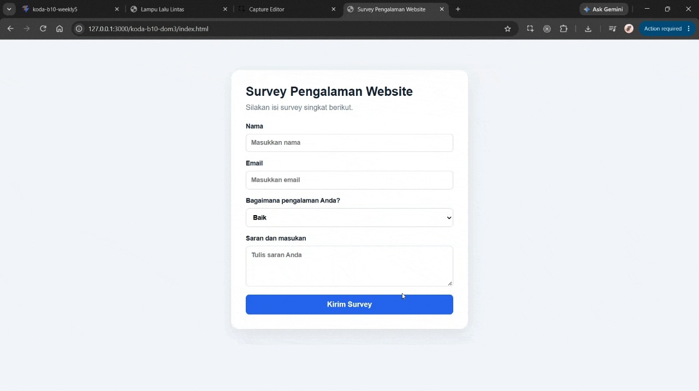

# Minitask 3 - Form Survey

## Hasil

JavaScript membuat sebuah form survey yang berisi nama, email, penilaian pengalaman, saran, dan tombol kirim.

## Penjelasan

Elemen dibuat menggunakan `document.createElement()`, kemudian dimasukkan ke halaman menggunakan `append()`. Elemen utama juga dibuat dari JavaScript dan ditambahkan langsung ke `document.body`.

Tidak ada penggunaan `innerHTML`. Event untuk memproses pengiriman form belum ditambahkan karena `addEventListener()` belum termasuk materi sebelum minitask ini. Struktur form sebelumnya tidak tersedia di materi yang diberikan, sehingga contoh ini memakai susunan survey sederhana.
